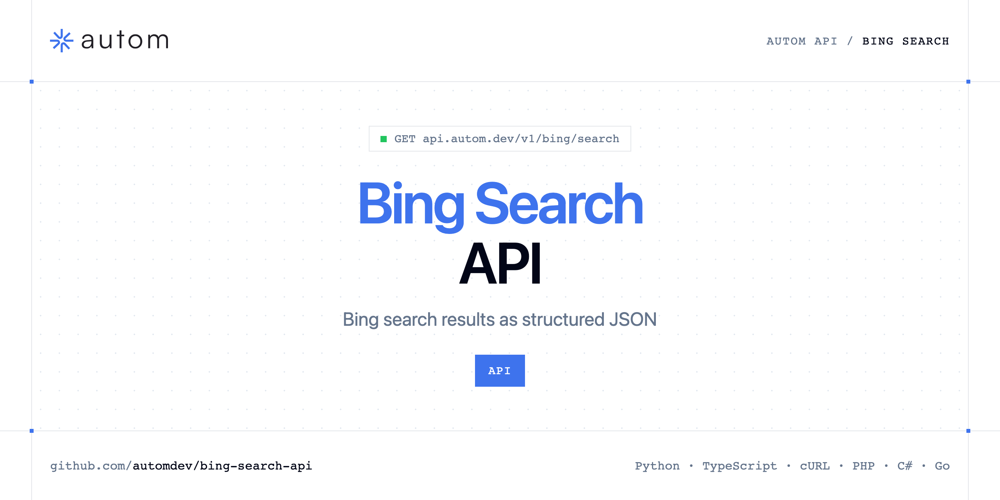

<p align="center">
  <a href="https://www.autom.dev"></a>
</p>

# Bing Search API

[](https://discord.gg/CFj3ph8aHU) [](https://app.autom.dev/register) [](https://docs.autom.dev) [](LICENSE)

The **Autom Bing Search API** returns Bing search results as structured JSON.

- **Bing Search API** — Query Bing Search via API and retrieve structured organic results (title, link, snippet, position).

Use it for rank tracking on Bing, SEO research or LLM grounding.

| Endpoint | Request | Credits |
|---|---|---|
| [Bing Search API](#bing-search-api) | `GET /v1/bing/search` | 1 |

## Table of contents

- [How it works](#how-it-works)
- [Bing Search API](#bing-search-api)
- [Code examples in other languages](#code-examples-in-other-languages)
- [Use cases](#use-cases)
- [Why Autom?](#why-autom)
- [FAQ](#faq)
- [Official SDKs](#official-sdks)
- [Related repositories](#related-repositories)
- [Support](#support)

## How it works

1. **Create a Autom account** and copy your API key from the [dashboard](https://app.autom.dev/register).
2. **Call `https://api.autom.dev`** with the header `x-api-key: YOUR_API_KEY`.
3. **Use the result** in your app — no infrastructure to run.

```bash
export AUTOM_API_KEY="your-api-key"
pip install requests        # Python
# TypeScript: Node.js 18+ (native fetch), run with `npx tsx file.ts`
```

## Bing Search API

Query Bing Search via API and retrieve structured organic results (title, link, snippet, position).

`GET https://api.autom.dev/v1/bing/search` · **1 credit per request** · [API reference](https://app.autom.dev/openapi)

### Request parameters

| Parameter | In | Type | Required | Description |
|---|---|---|---|---|
| `query` | query | string | ✅ | The search query you want to run on Bing. |
| `page` | query | number | — | Page number for pagination (1 = first page). |
| `num` | query | number | — | Number of results per page (e.g. 10, 20, 50). This value is a suggestion. |
| `location` | query | string | — | Search origin location (e.g. city). |
| `lat` | query | number | — | GPS latitude for the search origin. |
| `lon` | query | number | — | GPS longitude for the search origin. |
| `mkt` | query | string | — | Market code where results come from (e.g. `en-US`). Cannot be used together with `cc`. |
| `cc` | query | string | — | Country code to search from (2-letter ISO 3166-1). Cannot be used together with `mkt`. |

### Python example

```python
import os

import requests

API_KEY = os.environ["AUTOM_API_KEY"]
HEADERS = {"x-api-key": API_KEY}

response = requests.get(
    "https://api.autom.dev/v1/bing/search",
    headers=HEADERS,
    params={
        "query": "home",
    },
    timeout=120,
)
response.raise_for_status()

data = response.json()
print(data)
```

### TypeScript example

```typescript
type BingSearchApi = {
  pagination?: {
    next?: number;
    current?: number;
    has_next_page?: boolean;
  };
  organic_results?: {
    link?: string;
    title?: string;
    domain?: string;
    snippet?: string;
    position?: number;
  }[];
  search_parameters?: {
    q?: string;
    cc?: string;
    mkt?: string;
    page?: number;
    engine?: string;
  };
};

const headers = { "x-api-key": process.env.AUTOM_API_KEY!, "Content-Type": "application/json" };

const params = new URLSearchParams({
  "query": "home",
});

const response = await fetch(`https://api.autom.dev/v1/bing/search?${params}`, { headers });
if (!response.ok) throw new Error(`HTTP ${response.status}: ${await response.text()}`);

const data = (await response.json()) as BingSearchApi;
console.log(data);
```

### Output example

Example response from the API reference, abridged.

```json
{
  "pagination": {
    "next": 2,
    "current": 1,
    "has_next_page": true
  },
  "organic_results": [
    {
      "link": "https://openai.com/",
      "title": "OpenAI",
      "domain": "openai.com",
      "snippet": "OpenAI is an AI research and deployment company.",
      "position": 1
    }
  ],
  "search_parameters": {
    "q": "openai",
    "cc": "us",
    "mkt": "en-US",
    "page": 1,
    "engine": "bing"
  }
}
```

### Response fields

| Field | Type | Description |
|---|---|---|
| `pagination` | object |  |
| `pagination.next` | integer |  |
| `pagination.current` | integer |  |
| `pagination.has_next_page` | boolean |  |
| `organic_results[]` | object[] |  |
| `organic_results[].link` | string |  |
| `organic_results[].title` | string |  |
| `organic_results[].domain` | string |  |
| `organic_results[].snippet` | string |  |
| `organic_results[].position` | integer |  |
| `search_parameters` | object |  |
| `search_parameters.q` | string |  |
| `search_parameters.cc` | string |  |
| `search_parameters.mkt` | string |  |
| `search_parameters.page` | integer |  |
| `search_parameters.engine` | string |  |

## Code examples in other languages

Ready-to-run examples live in [`examples/`](examples); each reads your key from `AUTOM_API_KEY`.

| Language | `bing-search` |
|---|---|
| cURL (Bash) | [bing_search.sh](examples/curl/bing_search.sh) |
| PHP | [bing_search.php](examples/php/bing_search.php) |
| C# | [BingSearch.cs](examples/csharp/BingSearch.cs) |
| Go | [bing_search.go](examples/go/bing_search.go) |
| Java | [BingSearchExample.java](examples/java/BingSearchExample.java) |
| Ruby | [bing_search.rb](examples/ruby/bing_search.rb) |
| Node.js | [bing_search.mjs](examples/nodejs/bing_search.mjs) |

## Use cases

- **Rank tracking** — Track positions on Bing.
- **LLM grounding** — Feed agents with fresh results.

## Why Autom?

- **Every SERP in one API** — Google Search, AI Mode, Maps, News, Shopping, Images, Videos, Jobs, Autocomplete, plus Bing and Brave.
- **Structured JSON** — documented fields instead of brittle HTML parsing.
- **Geo & language targeting** — search like a user from the country and language you need.
- **One API key, one header** — `x-api-key` on every request.
- **Copy-paste examples** — Python and TypeScript in each README, 7 more languages in `examples/`.

## FAQ

### How do I authenticate?

Create an account on [Autom](https://app.autom.dev/register), copy your API key and send it in the `x-api-key` header of every request to `https://api.autom.dev`.

### How much does a request cost?

Credits per call: `/v1/bing/search` **1**. See [Autom pricing](https://www.autom.dev/pricing).

### Which languages are supported?

Any language that can make an HTTP request. This README shows Python and TypeScript; the [`examples/`](examples) folder contains cURL, PHP, C#, Go, Java, Ruby and Node.js.

## Official SDKs

Use Autom from your own language with a typed client:

| SDK | Package | Install |
| --- | --- | --- |
| Node.js | [`@automdev/sdk`](https://www.npmjs.com/package/@automdev/sdk) | `npm install @automdev/sdk` |
| Python | [`automdev`](https://pypi.org/project/automdev/) | `pip install automdev` |
| Go | [`autom-go`](https://pkg.go.dev/github.com/automdev/autom-go) | `go get github.com/automdev/autom-go` |
| .NET | [`Autom`](https://www.nuget.org/packages/Autom) | `dotnet add package Autom` |
| Ruby | [`autom`](https://rubygems.org/gems/autom) | `gem install autom` |
| PHP | [`autom/sdk`](https://packagist.org/packages/autom/sdk) | `composer require autom/sdk` |
| Java | [`autom-java`](https://github.com/automdev/autom-java) | build from source, see its README |
| CLI | [`@automdev/cli`](https://www.npmjs.com/package/@automdev/cli) | `npm install -g @automdev/cli` |
| MCP server | [`@automdev/mcp`](https://www.npmjs.com/package/@automdev/mcp) | `npx -y @automdev/mcp` |

## Related repositories

- [Google Search API](https://github.com/automdev/google-search-api)
- [Google AI Mode API](https://github.com/automdev/google-ai-mode-api)
- [Google Maps API](https://github.com/automdev/google-maps-api)
- [Google News API](https://github.com/automdev/google-news-api)
- [Google Shopping API](https://github.com/automdev/google-shopping-api)
- [Google Images API](https://github.com/automdev/google-images-api)
- [Google Videos API](https://github.com/automdev/google-videos-api)
- [Google Jobs API](https://github.com/automdev/google-jobs-api)
- [All Autom repositories](https://github.com/automdev)

## Support

- 💬 Join the [Discord](https://discord.gg/CFj3ph8aHU) to ask questions and share what you build.
- 📚 Read the [API reference](https://docs.autom.dev).
- 🔑 [Get your API key](https://app.autom.dev/register).

---

<p align="center">
  <a href="https://www.autom.dev">
    <picture>
      <source media="(prefers-color-scheme: dark)" srcset="images/logo-dark.svg">
      
    </picture>
  </a>
  <br>
  <sub>Built by <a href="https://www.autom.dev">Autom</a>. Examples are released under the MIT license.</sub>
</p>
